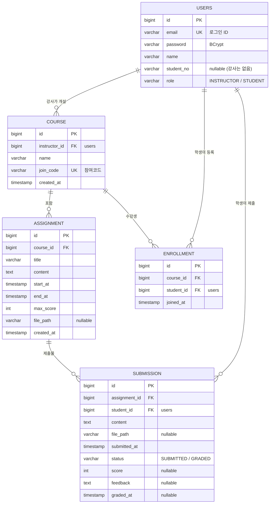

# ERD (초안)

관계와 필수 컬럼은 고정이며, 컬럼을 추가하면 이유를 이 문서와 README에 기록합니다.

## 제약 조건

| 테이블 | 제약 | 목적 |
|--------|------|------|
| users | UNIQUE(email) | 로그인 ID 중복 방지 |
| course | UNIQUE(join_code) | 참여코드로 강좌를 하나만 찾도록 |
| enrollment | UNIQUE(course_id, student_id) | 같은 강좌 중복 등록 방지 |
| submission | UNIQUE(assignment_id, student_id) | 과제당 학생 1건 (B3) |

`users`는 PostgreSQL 예약어 `user`와 충돌하지 않도록 복수형 테이블명을 씁니다.

## 관계 요약
- users(강사) 1 : N course, course 1 : N assignment
- course N : M users(학생) — enrollment 중간 테이블
- assignment 1 : N submission, users(학생) 1 : N submission

## 규칙과 데이터의 연결

| 규칙 | 데이터에서 확인하는 방법 |
|------|--------------------------|
| B1 | `assignment.start_at ≤ now ≤ end_at` |
| B2 | `enrollment`에 (course_id, student_id) 행이 있는지 |
| B3 | `submission`에 (assignment_id, student_id) 행이 있으면 UPDATE |
| B4 | `submission.status = 'GRADED'` |
| B5 | `course.instructor_id = 로그인한 강사 id` |
| B6 | `0 ≤ score ≤ assignment.max_score` |
| B7 | `assignment.end_at > start_at` |
| B8 | `submission`에 해당 assignment_id 행이 있는지 |

## 추가한 테이블 (X17)

제공된 ERD의 테이블 5개 외에, 여러 파일 첨부(X17)를 위해 `attachment` 테이블을 1개 추가했습니다.

| 컬럼 | 설명 |
|------|------|
| id | PK |
| assignment_id (nullable, FK) | 과제의 추가 첨부일 때 |
| submission_id (nullable, FK) | 제출의 추가 첨부일 때 |
| stored_name | 서버에 저장된 UUID 이름 |
| original_filename | 올린 원래 파일명 |
| created_at | 올린 시각 |

- CHECK: assignment_id와 submission_id 중 정확히 하나만 값이 있음
- 처음 올린 첨부 1개는 기존대로 `assignment.file_path` / `submission.file_path`에 있고, 그 밖의 첨부가 이 테이블에 쌓임 (과제 · 제출당 총 5개까지)
- 관계: assignment 1 : N attachment, submission 1 : N attachment

## 추가한 컬럼

제공된 ERD에 없지만 구현하면서 추가한 컬럼입니다. 이유는 README의 "추가한 컬럼과 이유"에도 기록합니다.

| 컬럼 | 이유 | 추가한 기능 |
|------|------|-------------|
| assignment.original_filename (nullable) | 저장명(`file_path`)은 UUID이므로 다운로드 시 원래 파일명을 보여 주기 위해 | I3-b (확정) |
| submission.original_filename (nullable) | 제출 파일의 저장명(`file_path`)도 UUID이므로 다운로드 시 학생이 올린 원래 파일명을 보여 주기 위해 | S3-b (확정) |
| submission.objection_content · objection_at (nullable) | 학생의 이의 신청 내용(500자 이하)과 신청 시각. 값이 있으면 신청한 것이고 제출당 1회만 가능 | X29 (확정) |
| submission.objection_response · objection_responded_at (nullable) | 강사의 이의 답변(500자 이하)과 답변 시각. 값이 있으면 답변 완료 | X29 (확정) |

## 추가 컬럼 후보

아래는 제공된 ERD에 없는 후보이며 **아직 확정하지 않았습니다.** 확정하면 이유를 적고 README에 반영합니다.

| 후보 | 이유 | 필요성 |
|------|------|--------|
| users.created_at | 가입일 기록 | 낮음 |
| course.description | 강좌 설명 표시 | 낮음 |
