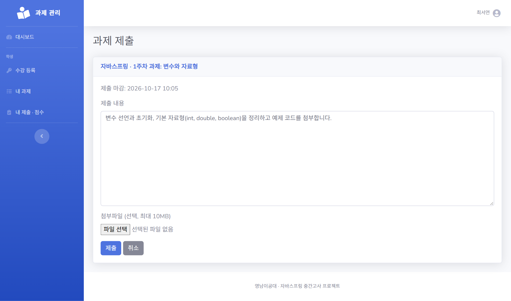
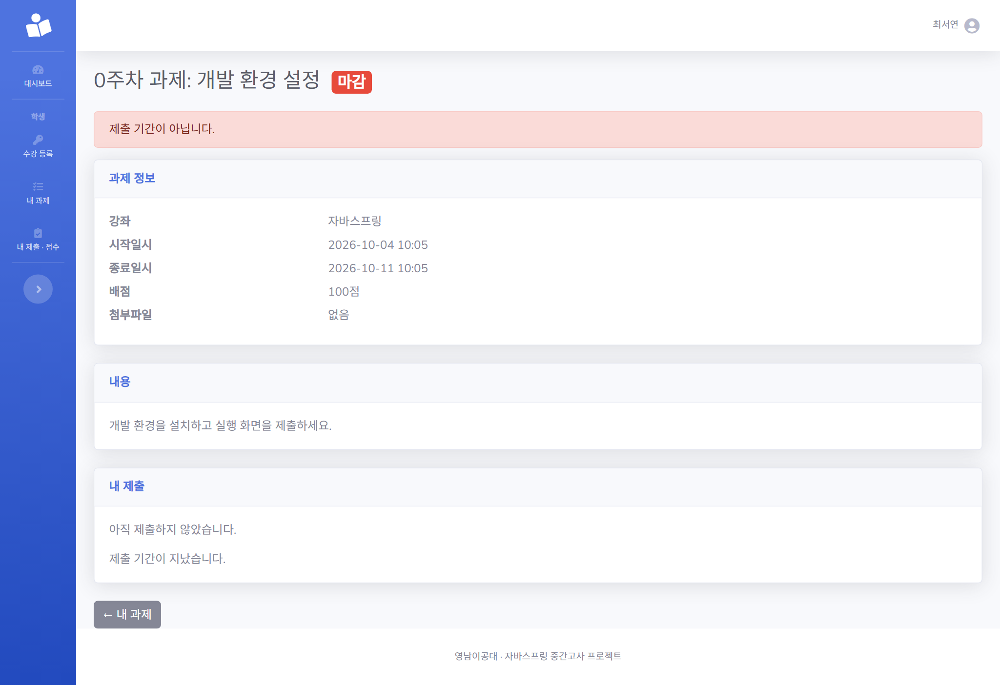
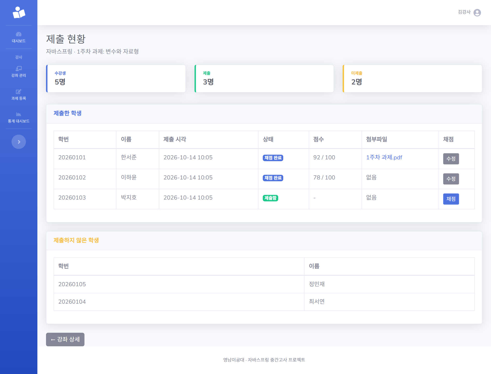
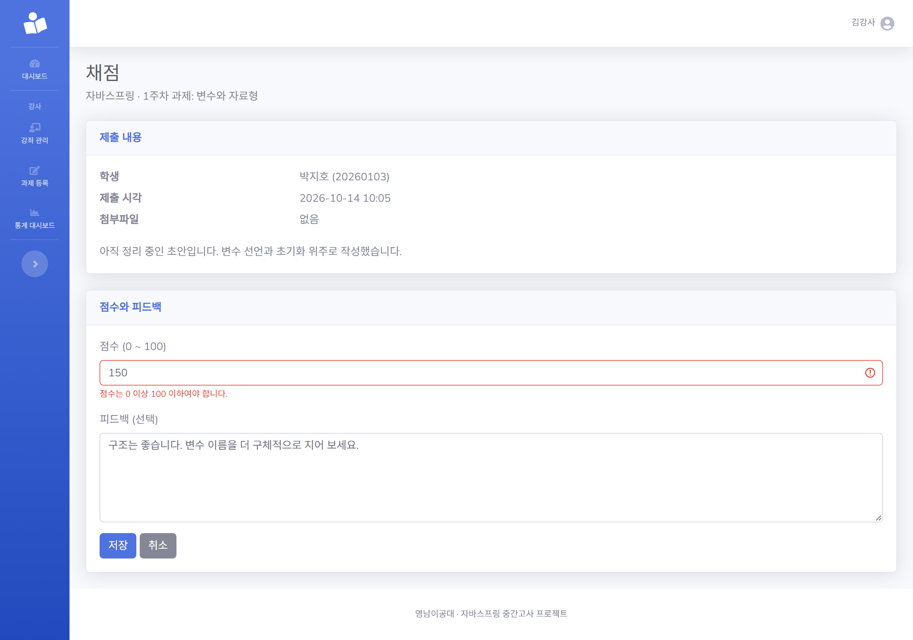
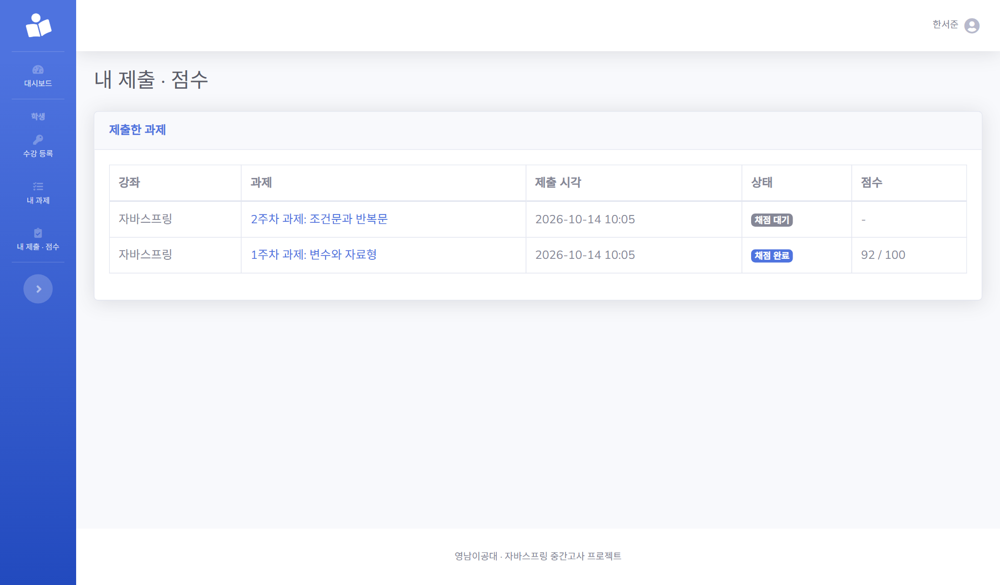
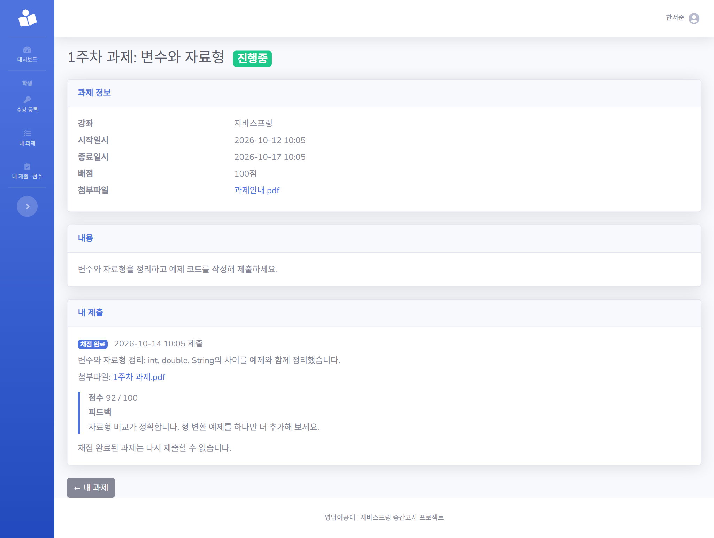
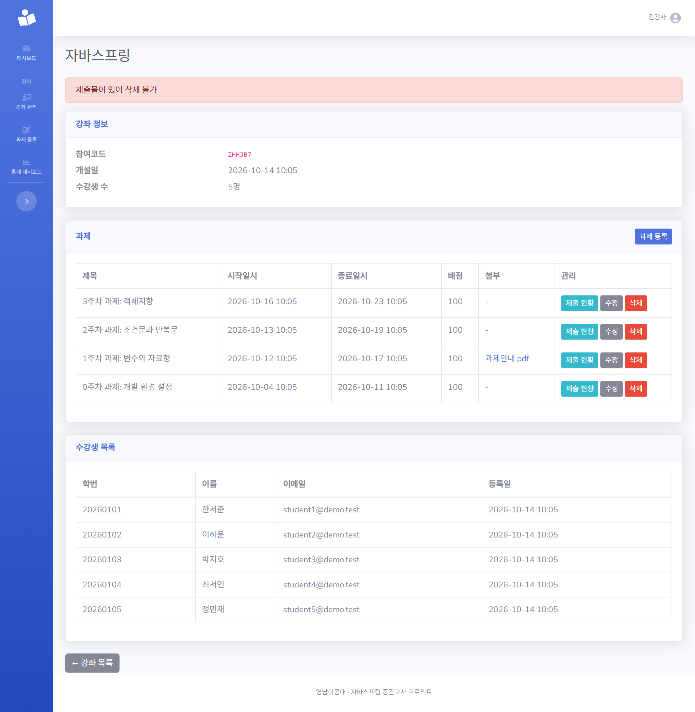
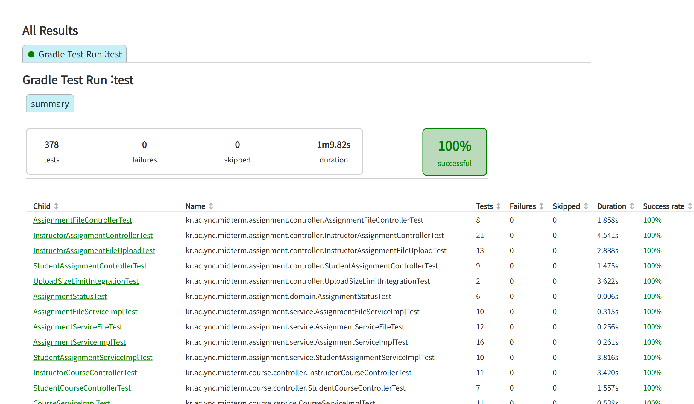

# 📋 W3 진행 보고 — 제출 · 채점

> 학생의 과제 제출 · 재제출(첨부파일 포함), 강사의 제출 현황과 채점, 학생의 결과 확인까지 **W3 범위(S3, I4, I5, S4)를 모두 구현**했습니다.
> 이로써 비즈니스 규칙 B1~B8이 모두 서버에 구현되었고, 전체 테스트 **378개가 통과**합니다. 규칙은 일부러 약하게 만들었을 때 테스트가 실패하는지까지 확인했고, W2에서 테스트로만 확인했던 B8은 이번에 화면으로 확인했습니다.

## 1. 체크포인트

| ID | 기능 | 상태 | 확인 방법 |
|:--:|------|:----:|-----------|
| S3-a | 과제 제출 · 재제출 (내용) | ✅ 완료 | 진행중인 과제에만 제출(B1), 두 번 제출해도 1건이고 덮어쓰기(B3), 채점 완료 후 재제출 거부(B4), 미수강 학생 403(B2). 시작 · 종료 정각 경계는 시각을 고정한 테스트로 확인 ([#27](https://github.com/daengsuk2/college_subject_site/pull/27)) |
| S3-b | 제출 첨부파일 업로드 · 다운로드 | ✅ 완료 | 한글 파일명 다운로드, 허용하지 않는 형식 · 10MB 초과 안내, 재제출 시 교체와 이전 파일 삭제, 제출한 본인과 담당 강사만 다운로드(다른 학생 · 다른 강사 403). 실제 서버에 11MB · 50MB를 올려 413 안내를 받는 것까지 확인 ([#29](https://github.com/daengsuk2/college_subject_site/pull/29)) |
| I4 | 제출 현황 (제출자 · 미제출자) | ✅ 완료 | 수강생 3명 중 2명 제출이면 제출 2명 · 미제출 1명, 제출 시각순 · 이름순 정렬, 수강생이 아닌 학생의 제출은 제외, 다른 강사 403(B5) ([#31](https://github.com/daengsuk2/college_subject_site/pull/31)) |
| I5 | 채점 · 피드백 | ✅ 완료 | 0점과 배점은 허용, 음수 · 배점 초과 · 빈 값 · 숫자가 아닌 값은 거부(B6), 재채점 가능, 채점 후 학생 재제출 거부(B4), 다른 강사 403(B5) ([#33](https://github.com/daengsuk2/college_subject_site/pull/33)) |
| S4 | 결과 확인 (내 제출 · 점수 · 피드백) | ✅ 완료 | 채점 전에는 "채점 대기", 채점 후에는 점수와 피드백 표시, 재채점이 학생 화면에 반영, 다른 학생의 제출 · 점수는 보이지 않음 ([#35](https://github.com/daengsuk2/college_subject_site/pull/35)) |

## 2. 적용한 규칙

W3으로 B1~B8이 모두 구현되었습니다. 모든 규칙은 화면이 아니라 서버(서비스)에서 검사합니다.

| 규칙 | 내용 | 적용 위치 | 확인 |
|:----:|------|-----------|------|
| B1 | 제출은 시작일시 ≤ 현재 ≤ 종료일시일 때만 | 제출 · 재제출 | 테스트 + 화면 (강제로 보낸 요청도 거부) |
| B2 | 수강 등록된 학생만 열람 · 제출 | 제출, 내 제출, 제출 파일 | 테스트 |
| B3 | 과제당 학생 1건, 기간 내 재제출은 덮어쓰기 | 제출 | 테스트 |
| B4 | 채점 완료된 제출은 재제출 불가 | 제출 | 실제 채점 서비스를 거친 테스트 |
| B5 | 강사는 본인 강좌만 | 제출 현황, 채점, 제출 파일 다운로드 | 테스트 |
| B6 | 점수는 0 이상 배점 이하 | 채점 | 테스트 + 화면 |
| B7 | 종료일시 > 시작일시 | 과제 등록 · 수정 (W2) | 화면 + 테스트 |
| B8 | 제출이 있는 과제는 삭제 불가 | 과제 삭제 (W2) | **화면으로 확인** + 테스트 |

## 3. 화면

> 아래 캡처는 **시연용 가짜 데이터**(가짜 이름 · 학번 · 이메일)로 촬영했습니다.

### 학생: 과제 제출 (S3)
내용을 입력하고 파일을 선택 사항으로 첨부합니다. 10MB를 넘는 파일은 선택하는 순간 안내가 뜨고, 서버에서도 다시 검증합니다.

### 제출 기간이 지난 과제에 강제로 제출 (B1)
화면에는 제출 버튼이 없지만, 서버로 직접 제출 요청을 보내도 거부되고 안내가 표시됩니다. (헤드리스 Chrome에서 CSRF 토큰을 포함한 폼을 스크립트로 직접 전송해 확인했습니다.)

### 강사: 제출 현황 (I4)
요약 카드(수강생 · 제출 · 미제출)와 제출한 학생 표, 제출하지 않은 학생 표가 나뉘어 있습니다. 채점한 제출은 점수가 보이고 버튼이 "수정"으로 바뀝니다.

### 강사: 채점과 점수 범위 검사 (I5, B6)
배점(100점)을 넘는 150점을 입력하면 점수 칸에 안내가 나오고, 입력한 값은 유지되며 저장되지 않습니다.

### 학생: 내 제출 · 점수 (S4)
채점 전에는 "채점 대기"와 `-`, 채점 후에는 "채점 완료"와 `점수 / 배점`이 표시됩니다. 사이드바의 "내 제출 · 점수" 메뉴가 이 화면으로 연결됩니다.

### 학생: 채점 결과 확인 (S4, B4)
과제 상세의 "내 제출" 카드에 점수와 피드백이 보입니다. 채점이 끝난 제출은 다시 제출할 수 없다는 안내도 함께 나옵니다.

### 제출이 있는 과제는 삭제할 수 없음 (B8)
W2에서는 제출 기능이 없어 테스트로만 확인했던 규칙입니다. 이번에 제출이 있는 과제의 삭제 버튼을 눌러 "제출물이 있어 삭제 불가" 안내를 화면으로 확인했습니다. 과제는 그대로 남아 있습니다.

### 테스트 결과

## 4. 작업 내용

| PR | 내용 |
|:--:|------|
| [#27](https://github.com/daengsuk2/college_subject_site/pull/27) | S3-a 과제 제출 · 재제출 (B1 · B2 · B3 · B4) |
| [#29](https://github.com/daengsuk2/college_subject_site/pull/29) | S3-b 제출 첨부파일 업로드 · 다운로드, `submission.original_filename` 컬럼 추가 |
| [#31](https://github.com/daengsuk2/college_subject_site/pull/31) | I4 제출 현황 (제출자 · 미제출자 목록) |
| [#33](https://github.com/daengsuk2/college_subject_site/pull/33) | I5 채점 · 피드백 (B5 · B6) |
| [#35](https://github.com/daengsuk2/college_subject_site/pull/35) | S4 결과 확인 (내 제출 · 점수 · 피드백) |

이슈: [#26](https://github.com/daengsuk2/college_subject_site/issues/26) · [#28](https://github.com/daengsuk2/college_subject_site/issues/28) · [#30](https://github.com/daengsuk2/college_subject_site/issues/30) · [#32](https://github.com/daengsuk2/college_subject_site/issues/32) · [#34](https://github.com/daengsuk2/college_subject_site/issues/34) · 보고서 [#36](https://github.com/daengsuk2/college_subject_site/issues/36)

## 5. 검증

- **전체 테스트 378개 통과**: W2 말 269개에서 시작해 S3-a 294개 → S3-b 314개 → I4 335개 → I5 361개 → S4 378개로 늘었습니다.
- **보안 · 비정상 입력 테스트**: 다른 학생 · 다른 강사 접근(403), 학생 · 강사 역할 교차 접근, CSRF 토큰 없음, 비로그인, 없는 대상(404), 숫자가 아닌 주소(400), 이름 · 제출 내용 · 파일명 · 피드백의 HTML 이스케이프(XSS), 경로 조작(`../`) 파일명, 범위 밖 점수를 화면 제한과 무관하게 직접 전송
- **실제 서버(Tomcat) 테스트**: 제출 폼에서도 9MB는 정상 제출, 11MB · 50MB는 연결이 끊기지 않고 413 안내를 받음 (W2에서 겪은 "10MB를 넘으면 멈춤" 문제의 재발 방지)
- **규칙을 일부러 약하게 만들었을 때 테스트가 실패하는지 확인** (모두 실패로 잡혔고, 확인할 때마다 원본으로 복원해 같은지 비교)

| 기능 | 약하게 만든 것 → 실패한 테스트 수 |
|------|-----------------------------------|
| S3-a | B1 기간 검사 제거 4 · 시작 정각 제외 1 · 종료 정각 제외 1, B2 수강 확인 제거 2, B3 덮어쓰기 제거 4, B4 채점 검사 제거 2 |
| S3-b | 다운로드 권한 검사 제거 2 · 학생 본인 확인 제거(B2) 1 · 강사 소유 확인 제거(B5) 1, 이전 파일 삭제 제거 1, B4 3, B1 5, 내려받기 대신 화면 표시 1, 검사보다 먼저 파일 저장 1 |
| I4 | B5 2, 수강생 아닌 제출 포함 2, 미제출자 계산 제거 7 · 조건 반전 8, 정렬 반대 3, 수강생 수 계산 제거 4, B8 1 |
| I5 | B5 3, B6 하한 검사 제거 1 · 상한 검사 제거 4 · 상한 경계 2 · 하한 경계 2, 채점 완료 상태 변경 안 함 9, 채점 시각 기록 안 함 3, 피드백 공백 정리 제거 1, B4 2 |
| S4 | 본인 필터 제거 2, 수강 강좌 조건 제거 1, 정렬 반대 3, 채점 전 점수 노출 2, 피드백 이스케이프 해제 1 |

## 6. 이슈와 해결

| 이슈 | 원인 | 조치 | 상태 |
|------|------|------|:----:|
| B4(채점 완료 후 재제출 불가)를 억지로 만든 상태로만 확인 | 채점 기능이 없던 S3-a 시점에는 테스트에서 상태를 강제로 바꿔야 했음 | I5에서 실제 채점 서비스로 채점한 뒤 재제출이 거부되는 것을 서비스 · 화면 두 곳에서 확인 | ✅ 해결 |
| W2에서 테스트로만 확인한 B8 | 제출 기능이 없었음 | 제출이 있는 과제를 삭제해 안내가 나오고 과제가 남는 것을 화면으로 확인 | ✅ 해결 |
| 이슈에 적은 제출 파일 저장 위치(`uploads/submissions/`)와 다르게 구현 | 기존 `FileStorage`가 폴더 하나에만 저장하는 구조이고, W2에서 검증한 방어 코드를 건드리는 변경이라 피함 | 과제 첨부와 같은 `uploads/` 폴더를 사용 (파일명이 UUID라 충돌 없음). PR에 이유를 기록 | ✅ 결정 |
| 이슈에 적은 "제출 상세 주소 403"이 별도 화면이 없어 그대로는 확인 불가 | 설계 결정으로 제출 상세를 새로 만들지 않고 과제 상세에 점수와 피드백을 붙임 | 같은 의도를 "본인 것만 보임"과 "수강하지 않는 학생은 과제 상세 403(B2)"으로 확인 | ✅ 결정 |
| 같은 학생이 동시에 두 번 제출하면 두 번째 요청이 안내 없이 오류 화면 | DB의 UNIQUE 제약이 1건은 보장하지만, 충돌 예외를 안내 문구로 바꾸지 않음 | 이월 (아이디어 문서 X30) | 🔍 미해결 |
| 과제 폼의 "내용" 입력칸 id가 공통 레이아웃의 `id="content"`와 중복 (W2에서 발견) | 레이아웃에 SB Admin 2의 `
`가 있고 입력칸도 같은 id를 사용 | 이번에 새로 만든 폼(제출 · 채점)은 겹치지 않는 id를 사용. 기존 과제 폼은 별도 수정 필요 | 🔍 미수정 |
| 전체 테스트가 오래 걸림 | 테스트 리포트 기준 실행 시간이 약 1분 10초이고 그 앞뒤로 컴파일과 스프링 기동 시간이 붙음. 가장 느린 것은 큰 파일을 올리는 제출 파일 테스트(측정 당시 약 16초) | 작업 중에는 관련 테스트만 실행하고 전체 실행은 커밋 전에 한 번. 1분 안쪽이라 구조는 그대로 둠 | ✅ 그대로 둠 |

## 7. 결정 사항

| 항목 | 결정 | 이유 |
|------|------|------|
| 제출 기간 판정 | 시작 · 종료 정각도 제출 가능, 마감 후에는 기존 제출도 수정 불가 | W2의 과제 상태 계산(`AssignmentStatus`)과 같은 기준을 재사용, 시각은 `Clock`으로 주입해 경계값을 테스트 |
| 검사 순서 | 과제 존재(404) → 수강(B2, 403) → 기간(B1) → 채점 완료(B4) → 파일 저장 | 권한 없는 요청에 존재 여부가 드러나지 않게 하고, 거부된 요청에서는 파일을 저장하지 않음 |
| 재제출 | 새로 만들지 않고 같은 제출을 덮어씀 (UNIQUE(과제, 학생)가 마지막 안전장치) | B3 |
| 제출 첨부 | 제출당 파일 1개, 과제 첨부와 같은 제한(확장자 목록, 10MB, UUID 이름) | `FileStorage` 재사용 |
| 제출 파일 다운로드 | `/submissions/{id}/file`, 제출한 본인과 해당 강좌 강사만, 항상 내려받기로 응답 | B2 · B5, 브라우저가 파일을 실행하지 않도록 |
| 추가 컬럼 | `submission.original_filename` | 다운로드 시 원래 파일명을 보여 주기 위해 (README · `docs/erd.md`에 기록) |
| 미제출자 계산 | 수강생 − 제출자를 쿼리 한 번으로 구함, 수강생이 아닌 학생의 제출은 제외 | 학생 수만큼 쿼리가 나가지 않게 |
| 제출 현황 정렬 | 제출자는 제출 시각이 이른 순, 미제출자는 이름 순 | 확인하기 쉽게 |
| 점수 검증 | 폼은 형식(빈 값 · 음수), 서비스는 배점 이하까지 최종 검사 | 배점은 과제마다 달라서 서비스가 판단하고, 화면 제한을 우회한 요청도 막음 |
| 재채점 | 허용, 채점 시각은 마지막 저장 시각으로 갱신 | 점수 수정 필요성 |
| 학생 결과 표시 | 채점 완료 즉시 공개, 별도 상세 화면 없이 과제 상세에 점수와 피드백 표시, 채점 전 배지는 "채점 대기" | 화면 설계에 상세가 따로 없고 제출 버튼이 이미 그 화면에 있음 |

## 8. 확인하지 못한 것 · 이월

- **브라우저에서 사람이 직접 눌러 보는 확인은 하지 않았습니다.** 화면은 MockMvc 테스트와, 위 캡처를 위한 헤드리스 Chrome 조작으로만 확인했습니다. B1을 "개발자도구로 강제 요청"하는 것도 스크립트로 폼을 직접 전송해 흉내 냈습니다.
- 같은 학생의 **동시 제출 · 같은 제출의 동시 채점**은 처리하지 않았습니다. 동시 제출은 안내 없는 오류 화면(위 표), 동시 채점은 마지막 저장이 적용됩니다.
- 학생이 점수를 보는 시점은 채점 완료 **즉시**입니다. 공개 시점을 조절하는 기능은 없습니다.
- 강사 사이드바의 **"통계 대시보드"**(`/instructor/stats`)는 W4에서 만들기 전이라 눌러도 404입니다. 위 강사 캡처의 사이드바에도 보입니다.
- 제출 파일은 **확장자만 검사**합니다. 이름만 바꾼 파일은 받을 수 있지만 다운로드는 항상 내려받기로만 응답합니다. (W2에서 이월)
- 업로드 중 DB 저장이 실패했을 때 방금 올린 파일을 지우는 코드는 있지만, 그 경로를 일부러 일으키는 테스트는 없습니다.
- 프롬프트 로그 제출 형식은 강사님께 확인이 필요합니다. (W1에서 이월)
- 과제 폼의 "내용" 입력칸 id 중복은 별도 수정이 필요합니다. (W2에서 이월)

## 9. 다음 주 (W4) 계획

| ID | 내용 | 비고 |
|:--:|------|------|
| I6 | 통계 대시보드: 강좌별 제출률, 과제별 평균 점수, 미제출자 | `/instructor/stats`, group by 쿼리와 Chart.js, 수치가 실제 데이터와 일치하는지 테스트 |
| S5 | 내 통계: 제출률, 평균 점수, 마감 임박 과제 | 마감 임박은 W2의 `Clock` · `AssignmentStatus` 재사용 ([아이디어 X15](ideas.md) 참고) |
| 마무리 | 시연 준비 | B1~B8을 시연에서 직접 시험하는 시나리오 점검, 프롬프트 로그 제출 형식 확인, README 최종 정리 |

- 시간이 남으면 이월 항목(id 중복 수정, 동시 제출 안내)부터 정리합니다.
- 선택 기능과 PR의 개선점은 [아이디어 · 추가 예정](ideas.md)에 정리해 두었습니다.
