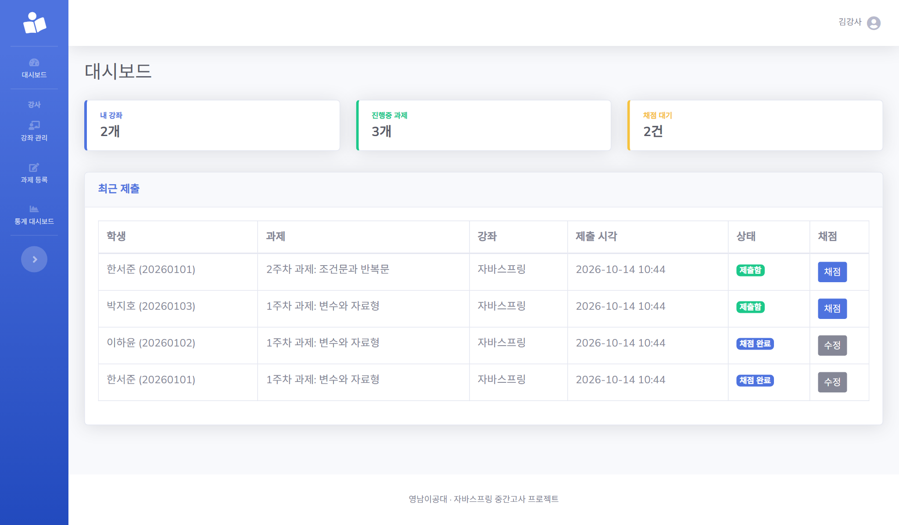
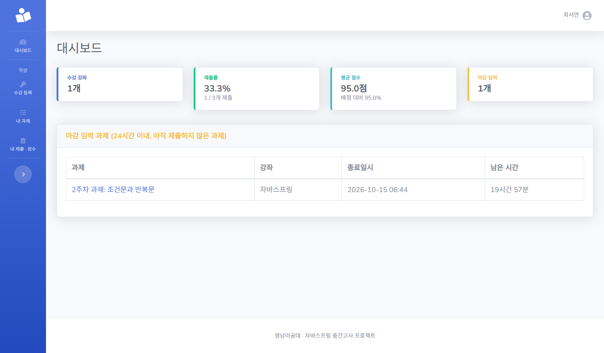
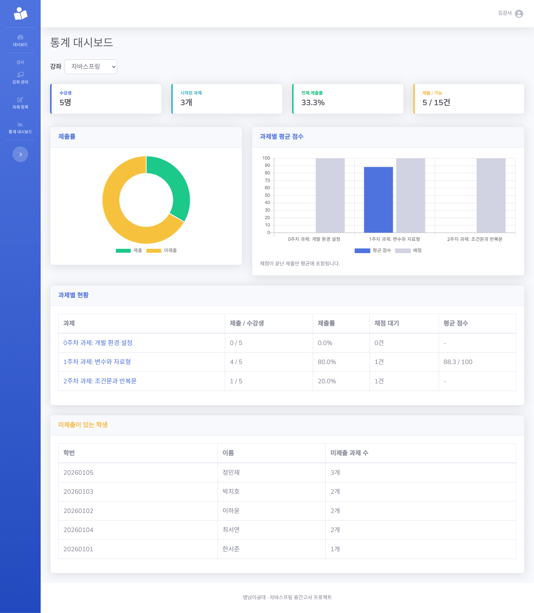
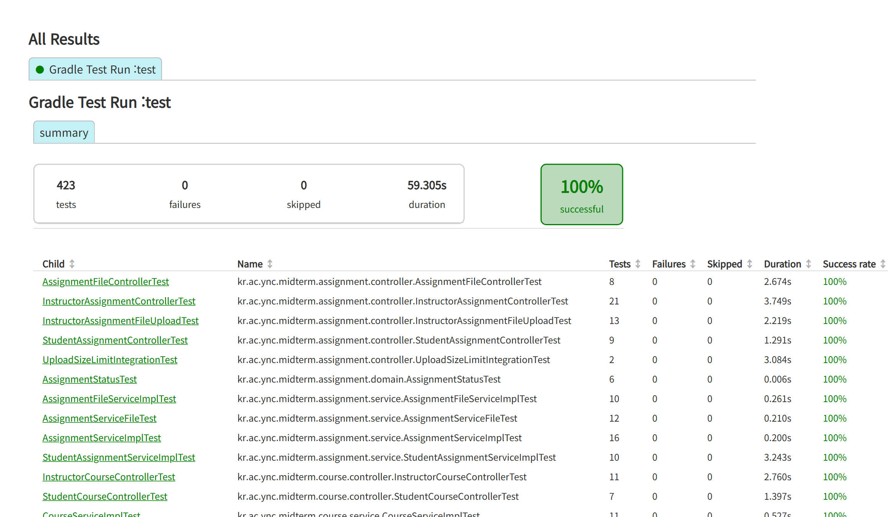

# 📋 W4 진행 보고 — 통계 + 마무리

> 강사의 통계 대시보드(I6)와 학생의 내 통계 · 역할별 대시보드(S5)를 구현해 **필수 기능 U1~U4, I1~I6, S1~S5를 모두 완료**했습니다.
> 전체 테스트는 **423개가 통과**하고, 시연 시나리오(B1~B8)를 가짜 데이터 환경에서 처음부터 끝까지 따라 해 **확인 36개가 모두 통과**했습니다. 시연 문서는 [docs/demo.md](demo.md)에 있습니다.

## 1. 체크포인트

| ID | 기능 | 상태 | 확인 방법 |
|:--:|------|:----:|-----------|
| I6 | 통계 대시보드 (제출률 · 평균 점수 · 미제출자) | ✅ 완료 | 수강생 3명 · 시작된 과제 2개 · 제출 4건이면 66.7%처럼 **손으로 계산한 값과 비교하는 테스트**, 채점 전 제출은 평균 제외, 재채점 반영, 예정 과제 · 수강생이 아닌 학생의 제출 제외, 다른 강사 403(B5), 빈 데이터. 실제 브라우저에서 차트 2개가 그려지는 것 확인 ([#39](https://github.com/daengsuk2/college_subject_site/pull/39)) |
| S5 | 내 통계 + 역할별 대시보드 | ✅ 완료 | 학생: 수강 강좌 수 · 제출률 · 평균 점수 · 마감 임박(24시간 경계 포함), 강사: 내 강좌 수 · 진행중 과제 수 · 채점 대기 수 · 최근 제출. 본인 데이터만 집계, 역할 분리, 빈 데이터 ([#41](https://github.com/daengsuk2/college_subject_site/pull/41)) |

## 2. 시연 시나리오 확인

[docs/demo.md](demo.md)의 시나리오를 가짜 데이터(강좌 2개, 학생 5명, 과제 5개, 사전 제출 · 채점)로 준비한 환경에서 **처음부터 끝까지 따라 해 보았습니다.** 헤드리스 Chrome으로 실제 폼을 입력하고 버튼을 눌러 진행했고, 단계마다 기대한 문구가 화면에 나오는지 확인했습니다.

| 규칙 | 시연에서 한 것 | 나온 화면 | 결과 |
|:----:|----------------|-----------|:----:|
| B1 | 마감 · 예정 과제에 제출 요청을 서버로 직접 전송 | "제출 기간이 아닙니다." (마감 과제에는 제출 버튼도 없음) | ✅ |
| B2 | 수강하지 않는 강좌의 과제 주소 접근 | HTTP 403 | ✅ |
| B3 | 같은 과제를 두 번 제출 | "다시 제출했습니다.", 제출 현황의 제출자는 4명 그대로(1인 1건) | ✅ |
| B4 | 채점 후 재제출 요청을 서버로 직접 전송 | "채점 완료된 과제입니다." | ✅ |
| B5 | 학생 계정으로 강사 화면 접근 (역할 제한) | HTTP 403 | ✅ (다른 강사의 강좌는 아래 참고) |
| B6 | 점수에 150 입력 | "점수는 0 이상 100 이하여야 합니다." | ✅ |
| B7 | 종료일시를 시작일시보다 이르게 입력 | "종료일시는 시작일시보다 뒤여야 합니다." | ✅ |
| B8 | 제출이 있는 과제 삭제 / 제출이 없는 과제 삭제 | "제출물이 있어 삭제 불가" (과제 유지) / "과제가 삭제되었습니다." | ✅ |

그 밖에 통계 화면의 숫자(전체 제출률 33.3%, 제출 5 / 15건, 1주차 평균 88.3 / 100)와 차트 2개, 학생 대시보드(제출률 66.7%, 평균 92.0점)도 계산한 값과 일치함을 확인했습니다. 36개 확인 중 실패는 없었고, 이 과정에서 새로 발견한 문제도 없었습니다.

## 3. 화면

> 아래 캡처는 **시연용 가짜 데이터**(가짜 이름 · 학번 · 이메일)로 촬영했습니다.

### 강사 대시보드 (S5)
내 강좌 수, 진행중 과제 수, 채점 대기 수와 최근 제출 표가 나옵니다. 채점 대기 건에서 채점 화면으로 바로 이동할 수 있습니다.

### 학생 대시보드 (S5)
수강 강좌 수, 제출률, 평균 점수(배점 대비 비율 포함), 마감 임박 수가 나오고, 24시간 이내에 마감되는 미제출 과제가 목록으로 보입니다. (시연 주인공 계정 기준)

### 통계 대시보드 (I6)
강좌를 고르면 제출률 도넛 차트, 과제별 평균 점수 막대 차트(배점과 함께), 과제별 표, 미제출이 있는 학생 표가 나옵니다.

### 테스트 결과

## 4. 작업 내용

| PR | 내용 |
|:--:|------|
| [#39](https://github.com/daengsuk2/college_subject_site/pull/39) | I6 통계 대시보드 (제출률 · 평균 점수 · 미제출자, Chart.js) |
| [#41](https://github.com/daengsuk2/college_subject_site/pull/41) | S5 내 통계 + 역할별 대시보드 |

이슈: [#38](https://github.com/daengsuk2/college_subject_site/issues/38) · [#40](https://github.com/daengsuk2/college_subject_site/issues/40) · 보고서 [#42](https://github.com/daengsuk2/college_subject_site/issues/42)

## 5. 검증

- **전체 테스트 423개 통과**: W3 말 378개에서 I6 402개 → S5 423개로 늘었습니다.
- **통계는 손으로 계산한 값과 비교**: 제출률 = 제출 건수 / (수강생 수 × 시작된 과제 수), 평균은 채점된 제출만, 마감 임박은 종료까지 24시간 이내이면서 미제출인 과제(정확히 24시간은 포함, 24시간 1초는 제외). 시작 · 종료 정각 경계와 빈 데이터(0으로 나누지 않음)도 확인했습니다.
- **본인 데이터만 집계**: 학생은 수강 강좌와 본인 제출만, 강사는 본인 강좌의 수강생 제출만 집계하고, 다른 학생 · 다른 강좌 · 수강생이 아닌 학생의 데이터가 섞이지 않는 것을 확인했습니다.
- **XSS**: 강좌명 · 과제 제목 · 학생 이름에 HTML이나 `</script>`가 있어도 이스케이프됩니다. (차트 데이터의 제목은 자바스크립트 문자열로 이스케이프되어 한글이 `\uXXXX` 형태로 내려갑니다.)
- **실제 브라우저 확인**: 헤드리스 Chrome에서 통계 차트 2개가 그려지고 화면 숫자가 계산값과 일치함을 확인했습니다.
- **시연 시나리오 전체 확인**: 위 2번의 36개 확인이 모두 통과했습니다.
- **규칙을 일부러 약하게 만들었을 때 테스트가 실패하는지 확인**은 W2 ~ W3, 그리고 I6의 서비스 · 쿼리에서 했습니다. **S5(대시보드)에서는 시간이 오래 걸려 하지 않기로 했습니다.** (아래 6번 참고)

## 6. 이슈와 해결

| 이슈 | 원인 | 조치 | 상태 |
|------|------|------|:----:|
| I6 테스트의 빈틈 | 규칙을 약하게 만든 확인에서, "다른 강좌에서 낸 제출이 이 강좌의 미제출 계산에 섞이는" 경우를 잡는 테스트가 없었음 | 그 경우를 확인하는 테스트를 추가하고 실패로 잡히는 것을 확인 | ✅ 해결 |
| I6 차트 데이터 테스트가 처음에 실패 | 한글 과제 제목이 자바스크립트 유니코드 이스케이프(`주`)로 내려가는데 테스트는 한글 그대로를 기대함. 앱 동작은 정상 (브라우저에서 한글로 보임) | 테스트가 영문 제목으로 값을 비교하도록 수정 | ✅ 해결 |
| 규칙 약화 확인이 기능 하나에 10분 넘게 걸림 | 한 가지를 바꿀 때마다 컴파일과 스프링 기동이 새로 붙어 I6에서만 13번 실행함 | 사용자와 상의해 **S5부터는 이 확인을 하지 않기로 함** (테스트를 쓰고 통과시키는 것까지만). 이 결정은 S5 PR에 그대로 적음 | ✅ 결정 |
| B5(다른 강사의 강좌 403)를 시연에서 라이브로 보여 주기 어려움 | 강사 계정은 가입할 수 없고 `.env`로만 생성되어 보통 하나뿐 | 테스트로 확인했고, 시연 문서에 학생 계정으로 강사 화면을 여는 대체 방법과, 두 번째 강사 계정을 만드는 방법(리허설 때 확인 필요)을 적음 | ✅ 문서화 |
| 같은 학생의 동시 제출 시 두 번째 요청이 안내 없는 오류 화면 (W3에서 이월) | DB의 UNIQUE 제약이 1건은 보장하지만 충돌 예외를 안내로 바꾸지 않음 | 이월 → 이후 해결 (X30, 충돌을 안내 문구로 바꿔 보여 줌. 제출은 1건만 남음) | ✅ 해결 |
| 과제 폼의 "내용" 입력칸 id 중복 (W2에서 이월) | 공통 레이아웃의 `
`와 같은 id | 이월 → 이후 해결 (입력칸 id를 겹치지 않는 값으로 바꾸고 DuplicateIdTest로 확인) | ✅ 해결 |

## 7. 결정 사항

| 항목 | 결정 | 이유 |
|------|------|------|
| 제출률 | 제출 건수 / (수강생 수 × 시작된 과제 수), 예정 과제 제외 | 아직 낼 수 없는 과제를 미제출로 세면 숫자가 부풀려짐. 학생 대시보드는 같은 기준으로 "내가 제출한 과제 수 / 시작된 과제 수" |
| 평균 점수 | 채점 완료된 제출만, 학생 화면에는 배점 대비 비율을 함께 표시 | 채점 전 제출은 점수가 없고, 배점이 과제마다 달라 비교용으로 비율이 필요 |
| 마감 임박 | 진행중 · 종료까지 24시간 이내 · 아직 제출하지 않은 과제, 기준은 코드의 상수 하나 | 이미 낸 과제는 급하지 않음 |
| 통계 화면 | 강좌를 고르는 방식, 차트는 기존에 들어 있던 Chart.js 사용 | 집계 쿼리를 한 강좌 기준으로 단순하게 유지, 새 의존성 없음 |
| 차트 데이터 | 서버가 계산한 값을 내려 주고 그리기만 브라우저가 함 | 숫자를 테스트로 검증하기 위해 |
| 집계 방식 | group by 쿼리로 구함 (과제 · 학생 수만큼 쿼리가 나가지 않음) | 성능 |
| 새 컬럼 · 테이블 | 없음 (기존 `submission` · `enrollment` · `assignment` · `course` 조회만) | 테이블 5개 유지 |
| 대시보드 `/` | 역할별로 다른 데이터를 같은 화면(home)에서 보여 줌 | 기존 레이아웃 재사용 |

## 8. 확인하지 못한 것 · 이월

- **사람이 직접 브라우저에서 눌러 보는 확인은 하지 않았습니다.** 시연 시나리오와 화면 캡처는 헤드리스 Chrome으로 폼을 입력하고 버튼을 눌러 따라 했습니다. 시연 전에 직접 한 번 리허설해 보세요.
- 시나리오 확인에는 **파일 첨부 제출 · 다운로드를 넣지 않았습니다.** (파일 첨부는 W2 · W3의 테스트와 실제 서버 업로드 테스트로 확인했습니다.)
- **다른 강사의 강좌 403(B5)은 시연 환경에서 직접 보이지 못합니다.** 테스트로만 확인했습니다.
- S5(대시보드)에서는 규칙을 약하게 만들었을 때 테스트가 실패하는지 **확인하지 않았습니다.**
- 같은 학생의 **동시 제출 안내**, 같은 제출의 **동시 채점**(마지막 저장 적용)은 처리하지 않았습니다.
- 제출 파일은 **확장자만 검사**합니다. 이름만 바꾼 파일은 받을 수 있지만 다운로드는 항상 내려받기로만 응답합니다.
- 프롬프트 로그 제출 형식은 강사님께 확인이 필요합니다. (W1에서 이월)
- 과제 폼의 "내용" 입력칸 id 중복은 별도 수정이 필요합니다. (W2에서 이월)

## 9. 4주 전체 회고

### 주차별 요약

| 주차 | 범위 | 테스트 수 | 보고서 |
|:----:|------|:--------:|--------|
| W1 | 설계 문서, 기반 (회원가입 · 로그인 · 역할별 메뉴 · 강사 계정) U1~U4 | 41 | [W1](progress_w1.md) |
| W2 | 강좌 · 과제 (I1~I3, S1~S2), 첨부파일, 상태 배지 | 269 | [W2](progress_w2.md) |
| W3 | 제출 · 채점 (S3, I4, I5, S4), 제출 첨부파일 | 378 | [W3](progress_w3.md) |
| W4 | 통계 + 마무리 (I6, S5), 시연 시나리오 | 423 | 이 문서 |

### 비즈니스 규칙이 구현된 곳

모든 규칙은 화면이 아니라 서버(서비스)에서 검사합니다.

| 규칙 | 구현 위치 |
|:----:|-----------|
| B1 | `SubmissionServiceImpl.submit` (시작 · 종료 정각 포함, `Clock` 주입) |
| B2 | `StudentAssignmentServiceImpl`, `SubmissionServiceImpl`, `AssignmentFileServiceImpl` (수강 등록 확인 → 403). 제출 파일은 `SubmissionFileServiceImpl`이 본인 제출만 허용 |
| B3 | `SubmissionServiceImpl.submit` (기존 제출 덮어쓰기) + DB UNIQUE `uk_submission_assignment_student` |
| B4 | `SubmissionServiceImpl.submit` (채점 완료 거부) |
| B5 | `CourseServiceImpl`, `AssignmentServiceImpl`, `SubmissionStatusServiceImpl`, `GradingServiceImpl`, `SubmissionFileServiceImpl`, `StatsServiceImpl` (본인 강좌 확인 → 403) |
| B6 | `GradingServiceImpl.grade` (폼 검증은 형식, 배점 이하는 서비스가 최종 검사) |
| B7 | `AssignmentServiceImpl` (종료 > 시작) |
| B8 | `AssignmentServiceImpl.delete` (제출이 있으면 삭제 불가) |

### 잘한 점
- **기능마다 같은 흐름**(이슈 → 브랜치 → 코드와 테스트 → PR → 머지)을 지켜서 변경 기록이 PR 번호로 이어집니다.
- 경계값(시작 · 종료 정각, 10MB, 24시간)은 시각을 고정하거나 실제 서버로 확인했고, 통계 숫자는 손으로 계산한 값과 비교했습니다.
- W2에서 겪은 "10MB를 넘으면 화면이 멈추는" 문제는 원인(Tomcat이 거절한 요청의 본문을 일부만 읽고 연결을 끊음)을 찾아 고치고, 제출 경로까지 같은 회귀 테스트를 추가했습니다.
- 공개 저장소라서 `.env`와 `uploads/`는 올리지 않았고, 화면 캡처와 시연 데이터는 모두 가짜 데이터로 만들었습니다.

### 아쉬운 점
- I1 · S1을 테스트 없이 합쳤다가 W2에 보강했습니다. 이후에는 기능과 테스트를 같은 PR에 넣었습니다.
- 규칙을 약하게 만들어 테스트를 검증하는 일이 매우 오래 걸려(기능당 10분 이상), S5부터는 하지 않았습니다. 그만큼 S5의 테스트 신뢰도는 W2 ~ W3보다 한 단계 낮습니다.
- 사람이 직접 눌러 본 확인이 적고 자동 조작으로 대신한 부분이 많습니다.
- 전체 테스트가 약 1분 10초 걸립니다. (컨텍스트를 새로 띄우는 테스트가 많음)

### 남은 과제
- 과제 폼 id 중복 수정, 동시 제출 안내 (작은 수정)
- 프롬프트 로그 제출 형식 확인
- [아이디어 · 추가 예정](ideas.md)의 선택 기능 (마이페이지, 명단 확인 후 가입, 알림 등)
